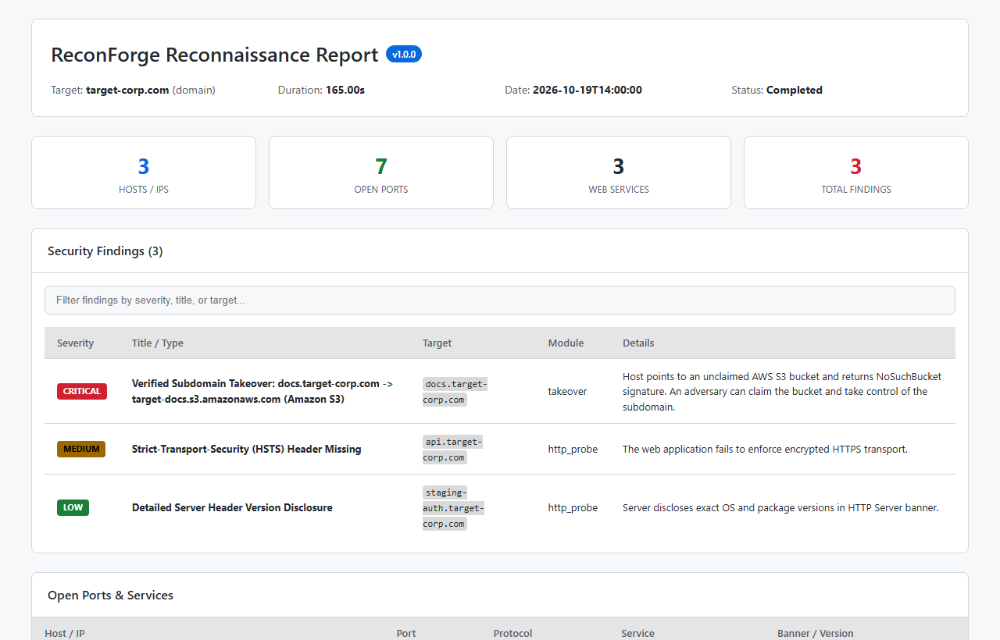
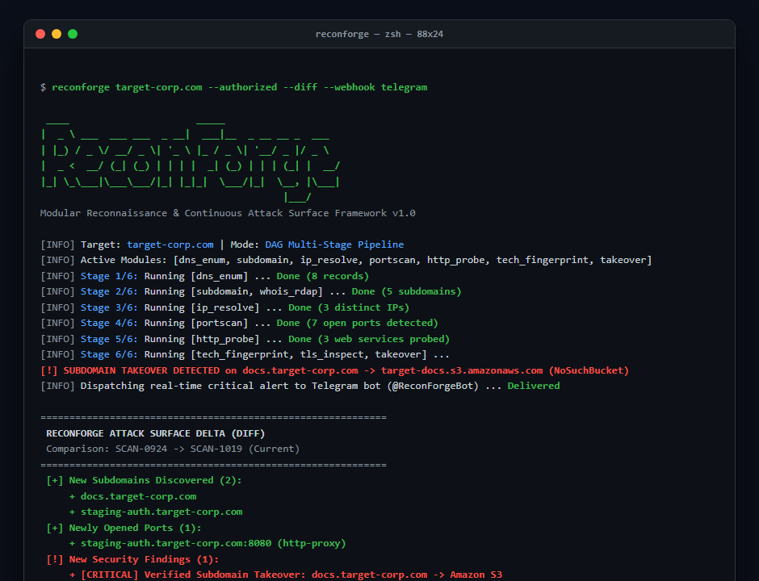

# ReconForge 🔍

<p align="center">
  
  
  
  
  
  
</p>

<p align="center">
  <strong>Next-Generation Asynchronous Attack Surface Management & Offensive Reconnaissance Framework</strong><br>
  <em>Engineered for Bug Bounty Hunters, Penetration Testers, and Red Teams.</em>
</p>

---

## 📸 Platform Previews

### 1. Interactive Dark-Mode Security Dashboard
> Self-contained, zero-dependency HTML report generated automatically after each assessment. Features instant client-side filtering, technology stack breakdowns, open port summaries, and CVSS-scored vulnerability findings.

<p align="center">
  
</p>

---

### 2. Live CLI Execution & Temporal State Diffing (`reconforge diff`)
> Terminal output highlighting DAG execution stages, live critical alert dispatching to Telegram, and automated delta identification (new subdomains, open ports, and vulnerabilities).

<p align="center">
  
</p>

---

## ⚡ Why ReconForge? (Architectural Differentiation)

Most public recon workflows on GitHub are **"bash glue scripts"** piping 10–15 separate compiled Go/C binaries (`subfinder | httpx | nuclei | naabu`). While functional, they suffer from fundamental engineering limitations:

| Architectural Challenge | Naive Bash Wrappers | ReconForge Engine |
|---|---|---|
| **Process Model** | Spawns dozens of subprocesses via pipes (CPU context-switch bloat). | **Single Python Asyncio Event Loop** with zero subprocess overhead. |
| **Pipeline Logic** | Blindly runs heavy scanners against dead or unresolvable hosts. | **DAG (Directed Acyclic Graph)** execution with strict dependency gating. |
| **Feedback Loop** | Linear pipeline; TLS certs are inspected at the end and discarded. | **Dynamic Feedback Loop**: Discovered TLS SANs feed back into DNS & port queues in real-time. |
| **False-Positive Control** | Floods targets; wildcard DNS & soft-404s pollute output. | **Pre-flight Wildcard Subtraction** + **Dynamic 3-probe Soft-404 Baseline Calibration**. |
| **Asset State Tracking** | Generates static flat text files with no history. | **Embedded SQLite EASM Engine** tracking deltas across chronological runs (`reconforge diff`). |
| **Real-Time Push Alerts** | Disconnected stdout logs; requires manual monitoring. | **Direct Multi-Platform Webhook Engine** (Telegram, Discord Embeds, Slack). |

---

## 🏗 System Architecture

```
                    ┌────────────────────────┐
                    │ Target Input (Domain,  │
                    │   IP, CIDR, or URL)    │
                    └───────────┬────────────┘
                                │
                                ▼
            [ Scope Validator & RFC 1918 Guardrails ]
                                │
                                ▼
  ┌────────────────────────────────────────────────────────────┐
  │                 DAG PIPELINE ORCHESTRATOR                  │
  │                                                            │
  │  Stage 1: dns_enum (A, AAAA, MX, TXT, SOA, AXFR, SPF)     │
  │     │                                                      │
  │     ▼                                                      │
  │  Stage 2: subdomain (crt.sh + brute) || whois_rdap         │
  │     │                                                      │
  │     ▼                                                      │
  │  Stage 3: ip_resolve (Forward DNS, PTR, Shared Infra)      │
  │     │                                                      │
  │     ▼                                                      │
  │  Stage 4: portscan (Async TCP Connect Scanner)             │
  │     │                                                      │
  │     ▼                                                      │
  │  Stage 5: http_probe (Redirects, Headers, Server Fingerprint)
  │     │                                                      │
  │     ▼                                                      │
  │  Stage 6: [Parallel Analysis & Vulnerability Auditing]     │
  │           ├── tech_fingerprint (MurmurHash3, Headers)      │
  │           ├── dir_enum (Soft-404 Calibrated Fuzzing)       │
  │           ├── tls_inspect (X.509 Ciphers & Protocol Audit) ─┐
  │           └── takeover (Dangling CNAME Verification)        │
  └─────────────────────────────┬──────────────────────────────┘
                                │  ▲
                                │  │ [TLS SAN Feedback Loop]
                                ▼  └── (Re-injects new hosts)
     ┌──────────────────────────────────────────────────────┐
     │           CONTINUOUS ATTACK SURFACE ENGINE           │
     │                                                      │
     │  • SQLite Historical State Database (reconforge.db) │
     │  • Delta Diff Engine (New Hosts, Closed/Open Ports) │
     │  • Multi-Platform Webhooks (Discord, Slack, Telegram)│
     │  • Dual Reporting (Strict JSON + Interactive HTML)   │
     └──────────────────────────────────────────────────────┘
```

---

## 🧩 Comprehensive Module Capabilities

| Module | DAG Stage | Prerequisites | Output Provided | Security & Offensive Utility |
|---|---|---|---|---|
| **`dns_enum`** | Stage 1 | None | `dns_records`, `nameservers`, `zone_transfer` | Complete DNS zone enumeration, AXFR zone transfer attempts, and domain email security analysis (SPF/DMARC spoofing audits). |
| **`subdomain`** | Stage 2 | None | `subdomains` | Hybrid passive Certificate Transparency (`crt.sh`) + active wordlist brute-force with automatic wildcard DNS subtraction. |
| **`whois_rdap`** | Stage 2 | None | `whois_info` | RESTful RDAP with fallback port-43 WHOIS queries for registrar, ASN mapping, and CIDR allocation. |
| **`ip_resolve`** | Stage 3 | `dns_records` | `ip_map`, `ptr_map` | High-throughput asynchronous hostname-to-IP resolution, PTR reverse lookups, and shared infrastructure cluster identification. |
| **`portscan`** | Stage 4 | `ip_map` | `open_ports`, `web_services` | Async TCP connect scanner with dynamic banner grabbing across Top-100, Top-1000, or custom port definitions. |
| **`http_probe`** | Stage 5 | `open_ports` | `http_services`, `web_urls` | Non-destructive HTTP probing, full redirect chain traversal, and security header audit (`HSTS`, `CSP`, `X-Frame-Options`, `CORS`). |
| **`tech_fingerprint`**| Stage 6 | `http_services` | `technologies` | Multi-vector technology detection via headers, session cookies, DOM regex, meta-generator tags, and favicon MurmurHash3. |
| **`dir_enum`** | Stage 6 | `http_services` | `directories` | Soft-404 calibrated directory enumeration targeting high-value exposures (`.git/HEAD`, `.env`, `wp-config.php`, backups, API docs). |
| **`tls_inspect`** | Stage 6 | `http_services` | `tls_info` | X.509 certificate parsing, protocol safety auditing (SSLv3/TLS 1.0/1.1), cipher suite verification, and SAN extraction. |
| **`takeover`** | Stage 6 | `subdomains` | `takeover_findings` | Dangling CNAME pointer verification and subdomain takeover detection across 12+ cloud providers (AWS S3, GitHub Pages, Heroku, Azure, Shopify, Fastly, etc.). |

---

## 🚀 Key Technical Innovations

### 1. Subdomain Takeover Verification (`takeover`)
Checks DNS `CNAME` records against a signature database of third-party cloud services. When an external pointer is found, it sends an HTTP request with the targeted `Host` header to match known error fingerprints (e.g. `NoSuchBucket`, `There isn't a GitHub Pages site here`, `No such app`) and verifies non-resolving targets returning `NXDOMAIN`. Verified takeovers are flagged with **CVSS 8.6 (Critical)**.

### 2. Continuous Attack Surface Monitoring (`reconforge diff`)
Maintains an embedded SQLite database (`reconforge_history.db`) to enable temporal delta tracking:
- **`+` Newly Discovered Subdomains**: Identifies assets deployed since the last scan.
- **`-` Decommissioned Assets**: Flags unresponsive or removed services.
- **`+` Newly Opened Ports**: Detects newly exposed administration interfaces or databases.
- **`!` Newly Introduced Vulnerabilities**: Highlights regressions immediately.
- **`*` Status Code Shifts**: Tracks endpoints moving from `403 Forbidden` to `200 OK`.

### 3. Multi-Platform Webhook Dispatcher
Integrated push notification subsystem that fires real-time alerts:
- **Telegram Bot API**: Delivers instant formatted mobile notifications (pre-configured with auto-chat discovery).
- **Discord Webhooks**: Dispatches rich embedded cards with color-coded severity sidebars.
- **Slack Incoming Webhooks**: Formats attachments into dedicated security triage channels.
- **Generic JSON**: Structured HTTP POST payload for SIEM or automation ingestion.

---

## 📦 Installation & Setup

### Requirements
- **Python 3.11+**
- Git

```bash
# Clone the repository
git clone https://github.com/YOUR_USERNAME/reconforge.git
cd reconforge

# Create and activate virtual environment
python -m venv venv

# Windows
venv\Scripts\activate

# Linux / macOS
source venv/bin/activate

# Install dependencies in editable mode
pip install -e ".[dev]"
```

### Environment Configuration
Copy the configuration template:
```bash
cp .env.example .env
```
Configure your alert credentials in `.env` (this file is excluded from Git):
```env
TELEGRAM_BOT_TOKEN=8636596361:AAHg...
TELEGRAM_CHAT_ID=
DISCORD_WEBHOOK_URL=https://discord.com/api/webhooks/...
```

---

## 💻 Usage & CLI Reference

### 1. Basic Authorization Scan
```bash
# Mandatory --authorized flag ensures compliance
reconforge example.com --authorized
```

### 2. Scan with Continuous Monitoring Diff & Telegram Alerts
```bash
reconforge example.com --authorized --diff --webhook telegram
```

### 3. Targeted Modular Scans
```bash
# Fast DNS + Subdomain + Takeover check
reconforge example.com --authorized -m dns_enum subdomain takeover

# Full scan with custom rate and port range
reconforge example.com --authorized --rate 150 --ports 80,443,8080,8443 -o ./my_reports
```

### 4. Attack Surface Diffing (`diff` Subcommand)
```bash
# List all historical assessments stored in SQLite
reconforge diff --list

# Compute the delta between the 2 most recent scans of a target
reconforge diff --target example.com

# Compare two explicit scan IDs
reconforge diff 7b4e39a8 a1f2c3d4
```

### 5. Telegram Alert Connection Test
```bash
# Verifies bot connectivity and auto-detects your Telegram Chat ID
reconforge test-telegram
```

---

## 🛡 Mandatory Ethical Guardrails

ReconForge is built with strict security controls to prevent unintended disruptions:

- **`--authorized` Flag Enforcement**: The engine refuses to execute without explicit confirmation of authorization.
- **Private RFC 1918 Defense**: Scans targeting private IP ranges (`10.0.0.0/8`, `172.16.0.0/12`, `192.168.0.0/16`) are blocked by default unless `--allow-private` is explicitly passed.
- **Non-Destructive Scanning**: Employs non-intrusive HTTP methods (`GET`/`HEAD`/`OPTIONS`).
- **Two-Tier Token Bucket Rate Limiter**: Enforces global requests-per-second constraints and connection pool ceilings.

---

## 🧪 Automated Test Suite

ReconForge includes full unit, integration, and mocking test coverage across all core systems:

```bash
python -m pytest tests/ -v
```

```
tests/test_core.py ....................                                  [ 43%]
tests/test_diff_engine.py ...                                            [ 50%]
tests/test_reporting.py ....                                             [ 58%]
tests/test_takeover.py ....                                              [ 67%]
tests/test_utils.py ........                                             [ 84%]
tests/test_webhook.py .......                                            [100%]

============================= 46 passed in 0.65s ==============================
```

---

## 📁 Repository Structure

```
reconforge/
├── .env.example                # Safe environment configuration template
├── pyproject.toml              # Modern PEP 621 package specification
├── README.md                   # Technical documentation & usage guide
├── wordlists/
│   └── subdomains.txt          # Curated high-probability subdomains
├── docs/
│   └── assets/                 # Architecture diagrams & UI previews
├── reconforge/
│   ├── cli.py                  # CLI entrypoint & subcommands
│   ├── core/
│   │   ├── models.py           # Strictly typed dataclasses (Target, Finding, ScanResult)
│   │   ├── context.py          # Shared scan context & thread executor
│   │   ├── orchestrator.py     # DAG pipeline runner & feedback loop
│   │   ├── scope.py            # CIDR/domain boundary validator
│   │   ├── limiter.py          # Dual token-bucket async rate limiter
│   │   ├── store.py            # Thread-safe in-memory result store
│   │   └── diff_engine.py      # SQLite historical database & delta diff engine
│   ├── modules/
│   │   ├── dns_enum.py         # DNS queries, zone transfer & email security
│   │   ├── subdomain.py        # CT logs & wordlist brute-force with wildcard baseline
│   │   ├── ip_resolve.py       # Forward/Reverse PTR DNS resolution
│   │   ├── portscan.py         # Async TCP connect scanner & banner grabber
│   │   ├── whois_rdap.py       # RDAP REST & port-43 WHOIS
│   │   ├── http_probe.py       # Security headers & web service prober
│   │   ├── tech_fingerprint.py # Header, cookie & MurmurHash3 fingerprinting
│   │   ├── dir_enum.py         # Soft-404 calibrated directory enumerator
│   │   ├── tls_inspect.py      # X.509 cert inspector & SAN extractor
│   │   └── takeover.py         # Dangling CNAME & subdomain takeover verifier
│   └── reporting/
│       ├── json_report.py      # Machine-readable JSON output
│       ├── html_report.py      # Jinja2 interactive dark-mode dashboard
│       └── webhook.py          # Multi-platform webhook dispatcher (Telegram/Discord/Slack)
└── tests/
    ├── test_core.py
    ├── test_diff_engine.py
    ├── test_reporting.py
    ├── test_takeover.py
    ├── test_utils.py
    └── test_webhook.py
```

---

## ⚖️ Legal Disclaimer

> **IMPORTANT:** ReconForge is created for educational purposes, legitimate security assessments, authorized penetration testing, and authorized bug bounty programs. Performing unauthorized port scanning, brute-forcing, or vulnerability assessment against systems without prior written authorization is illegal under the **Computer Fraud and Abuse Act (CFAA)** (18 U.S.C. § 1030) in the United States and equivalent international statutes. The authors assume no liability for misuse or damage caused by this program.

---

## 📜 License

Distributed under the **MIT License**. See [`LICENSE`](LICENSE) for details.
